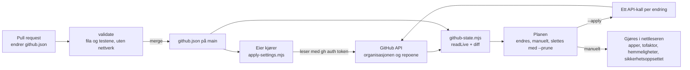
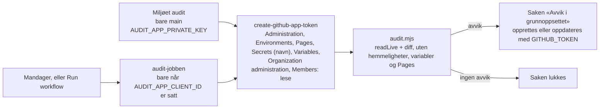
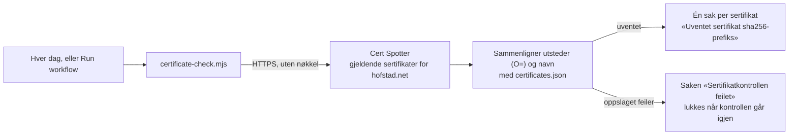
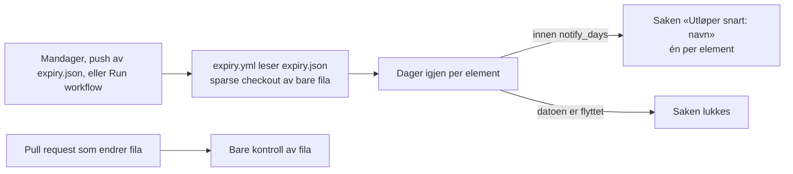

# Arkitektur

Hvordan kontrollene og skriptene i operations henger sammen. Bruken står i [README](../README.md), og gjenoppbyggingen
i [rebuild.md](rebuild.md).

## Oversikt

| Område | Valg | Hvorfor |
|---|---|---|
| Innstillinger | Én fil, `github.json`, med standardverdier og avvik per repo | Hele oppsettet kan leses og endres i en pull request |
| Lesing og sammenligning | `scripts/github-state.mjs`, brukt av både `apply-settings` og `audit` | Planen og kontrollen er alltid enige om hva som er avvik |
| Endringer i GitHub | `apply-settings.mjs`, kjørt lokalt av en eier | Ingen arbeidsflyt har skrivetilgang til organisasjonen |
| Ukentlig kontroll | GitHub-appen «HofstadNET Audit» med bare lesetilgang | `GITHUB_TOKEN` kan ikke lese andre repoer, og et personlig token skal ikke ligge i et repo |
| Sertifikater | Cert Spotter (Certificate Transparency) | Offentlig API, ingen nøkkel. Fanger sertifikater fra alle utstedere, også utenfor Cloudflare |
| Utløpsdatoer | `expiry.json` og `jq` i arbeidsflyten | Ingen kode fra repoet kjøres med skrivetilgang til saker utover å lese fila |
| Avhengigheter | Node uten pakker | Ingenting å oppdatere eller angripe utenom Actions |
| Synlighet | Offentlig repo | Se [0001](decisions/0001-public-operations-repo.md) |

## Innstillinger: plan og apply

`apply-settings.mjs` leser hele organisasjonen, sammenligner med `github.json` og viser planen. Med `--apply` gjøres
bare endringene merket «endres». Plassholdere som `${team:maintainers}` slås opp til id-er når kallet kjøres.

## Revisjon

Tokenet fra appen varer én time og trekkes tilbake når jobben er ferdig. Saken skrives med `GITHUB_TOKEN` i dette
repoet, så appen trenger ingen skrivetilgang.

## Sertifikatkontroll

## Utløpsdatoer

## Komponenter

| Del | Ansvar | Tilganger |
|---|---|---|
| `scripts/github-state.mjs` | Lese GitHub, utvide `github.json` med standardverdier og maler, sammenligne | Bare det tokenet den får |
| `scripts/apply-settings.mjs` | Plan, `--apply`, `--prune`, `--check`, `--manual`, `--validate` | Eierens token, lokalt |
| `scripts/audit.mjs` | Avvikene som Markdown-tabell | Token fra HofstadNET Audit (lese) |
| `scripts/certificate-check.mjs` | Uventede sertifikater som JSON-linjer | Ingen |
| `.github/workflows/audit.yml` | `validate` på pull requests, `audit` hver mandag | `contents: read`, `issues: write` |
| `.github/workflows/certificate-check.yml` | Kontroll hver dag | `contents: read`, `issues: write` |
| `.github/workflows/expiry.yml` | Varsler hver mandag | `contents: read`, `issues: write` |

## Beslutninger

- **Planen før endringer.** `apply-settings.mjs` endrer ingenting uten `--apply`, og sletter ingenting uten `--prune`.
  Alternativet, en arbeidsflyt som setter innstillingene etter merge, ville krevd et token med skrivetilgang til hele
  organisasjonen i GitHub Actions.
- **Apper og sikkerhetsoppsettet meldes, men endres ikke.** API-et kan ikke endre utvalget av repoer for en app, og
  sikkerhetsoppsettet gjelder alle repoene, så en feil der rammer alt.
- **Offentlig repo.** Se [0001](decisions/0001-public-operations-repo.md).
